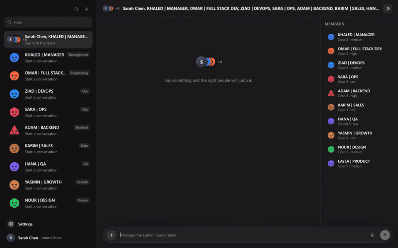

# OpenGrokBot

Self-hosted AI team chat with configurable agents, task routing, local tools, MCP connections, scheduled routines, and file previews. Built with TypeScript, Express, React and Electron. MIT licensed.



## Run locally

Requires **Node.js 22**, npm, and at least one configured model provider.

```bash
git clone https://github.com/mileadev/OpenGrokBot.git
cd OpenGrokBot
npm ci
npm run build
npm start                     # http://127.0.0.1:4310
# npm run dev                 # development UI
# npm run desktop             # Electron desktop
```

At first start, \`team.example.json\` is copied to the git-ignored \`team.json\`. Configure workspace, agents, model providers and approval policies in the UI. Use \`npm run typecheck && npm test\` to validate a checkout.

## Model backends

| Backend | Configuration | Authentication |
|---|---|---|
| Ollama on host | Providers → Ollama (local), \`http://127.0.0.1:11434/v1\` | No key for a loopback server |
| Ollama Cloud | Providers → Ollama Cloud, \`https://ollama.com/v1\` | Ollama API key; account/model availability required |
| Amazon Bedrock | Providers → Amazon Bedrock; region, optional AWS profile; model ID on the agent | AWS CLI v2 credential chain, AWS SSO, or IAM role |
| Other OpenAI-compatible endpoints | Providers → Custom API | Provider-specific key |
| Claude Code / Codex / Gemini CLI | Built-in providers | CLI login or explicitly supplied API key |

```bash
# Local model, on the same host
ollama pull qwen3:8b
ollama list
# Configure an agent model as qwen3:8b and provider as ollama.

# AWS SSO example. The AWS CLI v2 must be installed.
aws configure sso --profile opengrokbot
aws sso login --profile opengrokbot
aws bedrock list-foundation-models --region us-east-1 --profile opengrokbot
# Configure Bedrock provider: awsRegion=us-east-1, awsProfile=opengrokbot
# Select an available Converse-capable model or inference profile for that region.
```

**Bedrock permissions:** allow only \`bedrock:InvokeModel\` on the permitted model resources, plus SSO/STS identity permissions required by the selected AWS profile. Tool use is executed locally, and therefore requires an explicit tool approval policy. AWS usage incurs per-model charges. Bedrock runs via AWS CLI v2 \`converse\` and is non-streaming; the reply appears after each model turn.

**Ollama:** remote endpoints may expose code and chat content; use TLS and access controls. Ollama Cloud is billed according to the configured account. The application's local-tool layer is separate from Ollama.

## Deployment and security

Defaults: bound to \`127.0.0.1:4310\`; never expose this application directly to the public Internet. Prefer **Tailscale + HTTPS**, SSH forwarding or a private VPN. Network binding beyond loopback requires \`OPENGROKBOT_TOKEN\`. Start with \`HOST=127.0.0.1 npm start\`.

```bash
# For private-network access behind authenticated HTTPS reverse proxy:
HOST=0.0.0.0 OPENGROKBOT_TOKEN="$(openssl rand -hex 32)" npm start
```

Store that token in a private password manager or environment file; do not commit it. The login form uses a POST request and an HttpOnly cookie. Never pass tokens in URL query strings. All connected AI models can receive the conversation and tool outputs. Do not give agents access to production credentials or private file trees unless necessary.

**Threat model:** agent instructions may be untrusted. The local tools enforce a workspace boundary on file paths, but **shell execution is not an OS sandbox** and is disabled for standard OpenAI-compatible/Bedrock agents unless explicit bypass permissions are enabled. Provider SDKs/CLIs have their own permission behavior. For untrusted models, run the app as an unprivileged OS user in a disposable VM/container without sensitive mounts.

**Limitations:** smart routing and automatic memory compaction currently invoke Claude. Without Claude credentials they may fall back or skip memory updates. Bedrock integration requires AWS CLI v2 and an authorized Converse-capable model. Tool capabilities differ by model.

## Project

```text
server/             Express API, orchestration, auth, state, routines
server/providers/   Claude, Codex, Gemini, OpenAI-compatible, Bedrock
client/             React/Vite interface
shared/             Types and provider catalog
desktop/            Electron shell
team.example.json   Starter organization
```

State is persisted locally in \`team.json\` and \`data/\` (both git-ignored). Review \`server/approvals.ts\` before allowing file changes or shell commands. Use \`npm run typecheck\`, \`npm test\`, and \`npm run build\` before deployment.

## License

MIT. Original project by [Mahmoud Amr](https://github.com/Z4YT0N).
